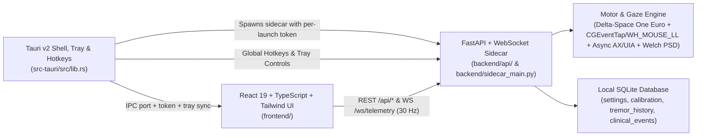

# ClearCursor

ClearCursor is a cross-platform desktop accessibility application for people living with Parkinson's disease, essential tremor, and fine-motor fatigue. It stabilizes mouse and trackpad movement across every application on macOS and Windows, prevents accidental drags and double-clicks, provides a webcam-based hands-free gaze mode, and records objective tremor metrics that patients can share with their physician.

## What ClearCursor Does

### For Patients, Caregivers, and Clinicians

- **Smooths Shaky Pointer Movement:** Filters involuntary 4-12 Hz hand tremors in real time while leaving deliberate arm movements responsive.
- **Stops Accidental Drags and Double-Clicks:** Locks cursor coordinates briefly on button press (Click-Freeze), blocks rapid involuntary double-click bounces, guards against accidental right-click twitches, and dampens jittery scroll reversals.
- **Widens Small Targets (Button Magnetism):** Detects nearby buttons, close icons, checkboxes, and menu items so a slowed pointer gently settles toward the control center.
- **Adapts to Medication Cycles:** One-tap presets (*Mild*, *Moderate*, *High*, and *Hands-Free Gaze*) let you adjust stabilization strength throughout the day as symptoms change.
- **Momentary Bypass and App Exclusions:** Hold a modifier key (such as `Alt`/`Option`) for raw freehand control whenever needed, hold a Precision key to slow the cursor to 35% speed, or add apps like Figma, Photoshop, or games to your auto-exclusion list.
- **Runs Quietly in the Menu Bar or System Tray:** Closing the window hides ClearCursor to the tray so pointer stabilization and background logging keep working.
- **Hands-Free Gaze Mode:** Use a standard webcam with gentle head or eye movement to move the cursor and click by dwelling or blinking.
- **Clinician Motor Report and Medication Diary:** Records real-world 4-6 Hz resting and 6-12 Hz action tremor power, millimeter-calibrated RMS tremor amplitude, time-of-day patterns, and rescued click counts alongside user-logged medication times. Export clean PDF reports (with embedded trend charts) or CSV files before clinic appointments.

> **Clinical Scope Note:** ClearCursor logs objective cursor displacement metrics and user-entered medication events to support discussions with your physician or occupational therapist. It is assistive accessibility software and is not a medical diagnostic device.

---

## Installation and Permissions

### End-User Desktop App (macOS and Windows)

Download the installer from Releases (`.dmg` on macOS, `.exe` or `.msi` on Windows), or build from source using the instructions below.

- **macOS:**
  - Drag **ClearCursor.app** into **Applications**.
  - When turning on **System-Wide Cursor Intercept**, grant **Accessibility** and **Input Monitoring** permissions in *System Settings -> Privacy & Security*.
  - When turning on **GazeControl**, grant **Camera** access when prompted.
- **Windows:**
  - Run the `.msi` or `.exe` installer and allow webcam access if using GazeControl.
  - Because of Windows User Interface Privilege Isolation (UIPI), a standard non-elevated application cannot filter cursor events inside elevated Administrator windows.

### Everyday Shortcuts

| Action | Shortcut | Notes |
| :--- | :--- | :--- |
| Toggle Stabilization ON/OFF | `Command+Shift+S` (Mac) / `Ctrl+Shift+S` (Windows) | Configurable in the Tuning tab |
| Emergency Stop All | `Command+Alt+Escape` (Mac) / `Ctrl+Alt+Escape` (Windows) | Immediately stops GazeControl and OS cursor interception |
| Hold-to-Bypass | Hold `Alt`/`Option` (default, configurable) | Temporarily passes raw cursor movement for drawing or fine edits |
| Precision Slow-Mode | Configurable (`Shift` / `Ctrl` / `Alt`) | Scales cursor movement down to 35% speed while held |

---

## Architecture



### Key Engineering Details

- **Delta-Space OS Interception (`backend/core/steadyhand/worker.py`, `os_tap.py`):** Rather than feeding OS-rewritten coordinates recursively back into the One Euro filter (which compounds lag and truncates pointer travel), ClearCursor reconstructs an independent physical trajectory from pointer deltas before smoothing and emitting bounded coordinates.
- **Non-Blocking Accessibility Gravity Wells (`backend/core/steadyhand/gravity_wells.py`):** `AXUIElementCopyElementAtPosition` (macOS) and `uiautomation.ControlFromPoint` (Windows) run on a throttled background thread so the OS mouse hook never stalls on cross-process IPC or trips `LowLevelHooksTimeout`.
- **Multi-Band Welch Spectral Telemetry (`backend/core/steadyhand/metrics.py`):** Computes Welch PSD across 0.5-15 Hz over active 2.5-4 second motion windows (tolerant of brief 1.5s pauses), separating 4-6 Hz resting power from 6-12 Hz action/essential tremor power alongside DPI-calibrated RMS amplitude in millimeters. Simulated demo runs (`simulated=1`) are excluded from clinical reports by default.
- **Local-First Security (`backend/api/main.py`, `src-tauri/src/lib.rs`):** The sidecar binds to `127.0.0.1` only. When started by Tauri, every API and WebSocket call (aside from `/api/health`) is authenticated with a per-launch random `X-ClearCursor-Token`. See [PRIVACY.md](PRIVACY.md) and [SECURITY.md](SECURITY.md).

---

## Repository Layout

```text
.
├── backend/
│   ├── api/                 # FastAPI REST endpoints, auth middleware, 30 Hz WebSocket hub
│   ├── core/                # SteadyHand DSP/OS hooks, GazeControl, settings, licensing boundary
│   ├── db/                  # Thread-safe SQLite repository with schema migration
│   └── sidecar_main.py      # PyInstaller standalone Uvicorn launcher
├── frontend/                # Vite + React 19 + TypeScript + Tailwind CSS UI
├── src-tauri/               # Tauri v2 Rust desktop shell, tray HUD, global shortcuts
├── chrome-extension/        # Optional Manifest V3 browser extension for web tabs
├── scripts/                 # Sidecar bundler (build_backend.py) and helper scripts
├── tests/                   # Pytest suite (DSP, OS hooks, DB, API, auth, sidecar)
├── archive/                 # Archived PySide6 hackathon prototype for reference
├── LICENSE                  # Apache License 2.0
├── PRIVACY.md               # Local-only data storage and deletion policy
├── SECURITY.md              # Local threat model and vulnerability disclosure
└── CONTRIBUTING.md          # Developer setup and PR guidelines
```

---

## Local Development

### Prerequisites

- **Python 3.10, 3.11, or 3.12** (`mediapipe` requires Python 3.12 or earlier)
- **Node.js 20+** and `npm`
- **Rust (`rustup` / `cargo`)** if building or running the Tauri desktop shell

### Setup

```bash
python3.12 -m venv .venv
source .venv/bin/activate         # Windows: .venv\Scripts\activate
pip install -r requirements.txt -r requirements-dev.txt
npm --prefix frontend install
```

### Run Development Stack

```bash
# Start both the FastAPI sidecar (127.0.0.1:8000) and Vite frontend (localhost:5173)
make dev
```

To run inside the native Tauri desktop window with tray and global shortcuts:

```bash
npm install
make dev-tauri
```

### Run Tests and Checks

```bash
make test
cargo check --manifest-path src-tauri/Cargo.toml
```

### Build Standalone Desktop Installers

1. Bundle the Python sidecar binary into `src-tauri/binaries/`:
   ```bash
   .venv/bin/python scripts/build_backend.py
   ```
2. Build the frontend and package the Tauri v2 installer (`.app`/`.dmg` on macOS, `.exe`/`.msi` on Windows):
   ```bash
   npm install
   make build
   ```

## License

Apache License 2.0. See [LICENSE](LICENSE).
