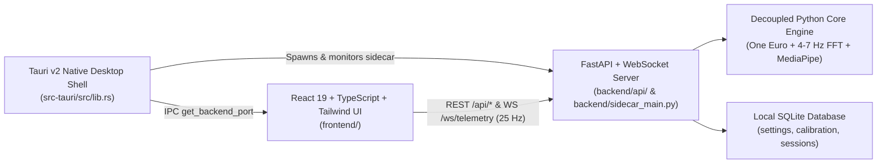

# TrueCursor

Desktop assistive motor stabilization and hands-free gaze control application for Parkinson's and neuromuscular accessibility workflows.

## Architecture



## Features

- **Control Deck:** Oversized `56px+` toggle cards for SteadyHand stabilization, GazeControl webcam tracking, 4-7 Hz simulated tremor injection, and live stability telemetry (`ws://127.0.0.1:<port>/ws/telemetry`).
- **10-Step Appointment Playground:** Interactive comparison canvas (`1. Doctor` -> `2. Date` -> `3. Time` -> `4. Review` -> `5. Book` repeated twice) showing inner vs. dashed extended click boundaries (`TargetManager`) alongside real-time shaky raw cursor (`raw_pos`) and One Euro stabilized cursor (`stable_pos`).
- **Sensitivity & Filter Tuning:** Stepped `-` / `+` controls alongside wide-track sliders for One Euro cutoff (`min_cutoff`), speed coefficient (`beta`), Anti-Drag thresholds, and gaze dwell latency, persisted to SQLite (`POST /api/settings`).
- **Guided Gaze Calibration:** Distraction-free 5-point or 9-point full-screen calibration modal saving affine profiles via `POST /api/calibrate`.
- **Session History:** SQLite-backed daily average stability trend chart and saved calibration profile table (`GET /api/sessions`).

## Repository Layout

```text
TrueCursor/
├── backend/
│   ├── api/                 # FastAPI REST endpoints & 25 Hz WebSocket hub
│   ├── core/                # PySide6-free SteadyHand FFT/One Euro & MediaPipe Gaze workers
│   ├── db/                  # Thread-safe SQLite repository
│   └── sidecar_main.py      # Standalone Uvicorn launcher & signal cleanup for PyInstaller
├── frontend/                # Vite + React + TypeScript + Tailwind CSS UI
├── legacy_ui/               # Archived PySide6 desktop prototype kept for reference
├── scripts/
│   └── build_backend.py     # Cross-platform PyInstaller --onefile sidecar bundler
├── src-tauri/               # Tauri v2 native desktop shell, permissions, and icons
└── tests/                   # Backend, core motor/gaze, API, and sidecar pytest suite
```

## Local Development

### Prerequisites
- **Python 3.10, 3.11, or 3.12** (MediaPipe requires `<= 3.12`)
- **Node.js 20+** and `npm`
- **Rust (`rustup` / `cargo`)** if building or running the native Tauri v2 desktop wrapper (`cargo tauri dev` / `build`)

### Setup

```bash
python3.12 -m venv .venv
source .venv/bin/activate         # Windows: .venv\Scripts\activate
pip install -r requirements.txt -r requirements-dev.txt
npm --prefix frontend install
```

### Run Web Dev Stack (FastAPI + Vite)

```bash
# Terminal 1: FastAPI backend & WebSocket telemetry on port 8000
.venv/bin/uvicorn backend.api.main:app --host 127.0.0.1 --port 8000 --reload

# Terminal 2: React frontend on http://localhost:5173
npm --prefix frontend run dev
```

Or run both concurrently via:

```bash
make dev
```

### Run Tests & Checks

```bash
make test
```

## Packaging a Standalone Desktop Installer

1. Build the standalone PyInstaller backend sidecar into `src-tauri/binaries/`:
   ```bash
   .venv/bin/python scripts/build_backend.py
   ```
2. Build the production React frontend (`frontend/dist/`) and package the native Tauri installer (`.app`/`.dmg` on macOS, `.exe`/`.msi` on Windows):
   ```bash
   npm install
   make build
   ```

Build installers on the target OS (macOS builds produce Apple Silicon / Intel `.app` & `.dmg`; Windows builds produce `.exe` / `.msi`). Automated tag builds (`v*`) are configured in `.github/workflows/release.yml`.

## End-User Installation & Permissions

- **macOS:** Open the `.dmg`, drag **TrueCursor.app** into **Applications**, and grant **Camera** access on first GazeControl launch plus **Accessibility / Input Monitoring** in *System Settings -> Privacy & Security* if enabling OS-wide pointer stabilization.
- **Windows:** Run the `.msi` / NSIS `.exe` installer and allow webcam access when prompted.
