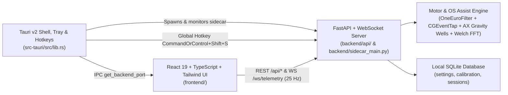

# TrueCursor

Desktop assistive motor stabilization and hands-free gaze control application for Parkinson's and neuromuscular accessibility workflows.

## Architecture



## Features

- **Patient-First Home Overview:** Plain-language guide explaining who TrueCursor supports, daily tremor challenges, real-time solutions, and 3-step onboarding with warm high-contrast visuals.
- **One-Tap Medication State Presets:** Switch seamlessly between *Mild Tremor (Responsive)*, *Moderate Tremor (Balanced)*, *High Tremor (Maximum Stabilization)*, and *Hands-Free (Gaze Mode)*, while fine-grained One Euro (`min_cutoff`, `beta`), Click-Freeze, and Gravity Well controls live inside an expandable **Advanced Tuning** drawer.
- **True System-Wide Cursor Interception & 180ms Click-Freeze:** Uses `CGEventTapCreate` (`kCGHIDEventTap` on macOS via `pyobjc-framework-Quartz`) with cross-platform `pynput` fallback to apply `OneEuroFilter` coordinate smoothing in-place before OS rendering, locking coordinates for 180ms on `MouseDown` (releasing early only on drags over 25px).
- **Accessibility Gravity Wells:** Queries the OS Accessibility tree (`AXUIElementCopyElementAtPosition` on macOS, `uiautomation` on Windows) at up to 45 Hz to gently magnetize slow-moving pointers onto small buttons, close boxes, menu items, and links (`2.5x` to `3x` virtual hitboxes).
- **Menu Bar / System Tray HUD & Global Hotkey:** Native Tauri tray controls show live state and toggle stabilization anywhere via `CommandOrControl+Shift+S`.
- **Dual-Trace Sandbox Lab & 10-Step Appointment Trial:** Compare dashed red raw tremor trajectories against solid green stabilized trails in real time alongside target buttons, checkboxes, and note inputs.
- **Clinician Motor Report (PDF & CSV):** Longitudinal Recharts stability and 4-7 Hz `scipy.signal.welch` tremor power trends stored in SQLite, exportable via `jspdf` + `jspdf-autotable` with descriptive clinical interpretations and a built-in *How to Read This Clinical Motor Report* guide.
- **Guided Gaze Calibration:** Distraction-free 5-point or 9-point full-screen calibration wizard saving affine profiles via `POST /api/calibrate`.

## Repository Layout

```text
TrueCursor/
├── backend/
│   ├── api/                 # FastAPI REST endpoints & 25 Hz WebSocket hub
│   ├── core/                # PySide6-free SteadyHand FFT/One Euro & MediaPipe Gaze workers
│   ├── db/                  # Thread-safe SQLite repository
│   └── sidecar_main.py      # Standalone Uvicorn launcher & signal cleanup for PyInstaller
├── frontend/                # Vite + React + TypeScript + Tailwind CSS UI
├── legacy_ui/               # Archived PySide6 desktop prototype kept for reference
├── scripts/
│   └── build_backend.py     # Cross-platform PyInstaller --onefile sidecar bundler
├── src-tauri/               # Tauri v2 native desktop shell, permissions, and icons
└── tests/                   # Backend, core motor/gaze, API, and sidecar pytest suite
```

## Local Development

### Prerequisites
- **Python 3.10, 3.11, or 3.12** (MediaPipe requires `<= 3.12`)
- **Node.js 20+** and `npm`
- **Rust (`rustup` / `cargo`)** if building or running the native Tauri v2 desktop wrapper (`cargo tauri dev` / `build`)

### Setup

```bash
python3.12 -m venv .venv
source .venv/bin/activate         # Windows: .venv\Scripts\activate
pip install -r requirements.txt -r requirements-dev.txt
npm --prefix frontend install
```

### Run Web Dev Stack (FastAPI + Vite)

```bash
# Terminal 1: FastAPI backend & WebSocket telemetry on port 8000
.venv/bin/uvicorn backend.api.main:app --host 127.0.0.1 --port 8000 --reload

# Terminal 2: React frontend on http://localhost:5173
npm --prefix frontend run dev
```

Or run both concurrently via:

```bash
make dev
```

### Run Tests & Checks

```bash
make test
```

## Packaging a Standalone Desktop Installer

1. Build the standalone PyInstaller backend sidecar into `src-tauri/binaries/`:
   ```bash
   .venv/bin/python scripts/build_backend.py
   ```
2. Build the production React frontend (`frontend/dist/`) and package the native Tauri installer (`.app`/`.dmg` on macOS, `.exe`/`.msi` on Windows):
   ```bash
   npm install
   make build
   ```

Build installers on the target OS (macOS builds produce Apple Silicon / Intel `.app` & `.dmg`; Windows builds produce `.exe` / `.msi`). Automated tag builds (`v*`) are configured in `.github/workflows/release.yml`.

## End-User Installation & Permissions

- **macOS:** Open the `.dmg`, drag **TrueCursor.app** into **Applications**, and grant **Camera** access on first GazeControl launch plus **Accessibility / Input Monitoring** in *System Settings -> Privacy & Security* if enabling OS-wide pointer stabilization.
- **Windows:** Run the `.msi` / NSIS `.exe` installer and allow webcam access when prompted.
